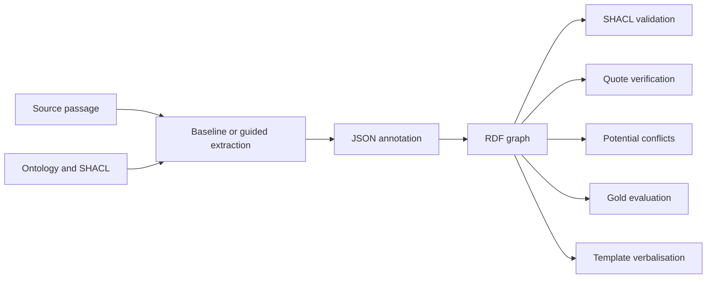

# Ontology-Guided RDF Extraction from Disputed Legal Narratives

A small research prototype for extracting reported payments and attributed claims from text. It compares ordinary structured prompting with ontology/SHACL guidance, records source quotations, and checks the resulting RDF for structural violations and potentially competing assertions.

The completed Qwen3.5-4B challenge experiment produced **89.6% baseline and 85.2% guided core-triple micro-F1**. Both conditions recovered 69 of 73 gold triples; guidance added eight false-positive triples. This negative result is useful: a longer schema-aware prompt can produce structurally plausible claims that the text does not support.

## Method



Both conditions use the same model, input passages, JSON schema, temperature and RDF builder. The guided condition adds semantic instructions, the ontology and SHACL shapes. The comparison therefore measures this combined prompting package, rather than isolating the effect of OWL alone. SHACL findings are reported without repairing the output.

A claim retains its speaker and legal qualification:

```turtle
ex:claim_D13 a ex:Claim ;
    ex:assertedBy ex:mira ;
    ex:concerns ex:transfer_q ;
    ex:hasQualification ex:loan ;
    ex:derivedFrom ex:doc_D13 .
```

`ObservedFact` means that an event is reported in the passage. It does not mean that the event has been independently verified. A document link is assigned by ingestion; `sourceText` is credited only when the extractor supplies an exact substring. Exact matching alone does not establish entailment.

## Data

All 48 passages are authored synthetic examples with fictional parties.

| Split | Passages | Core gold triples | Composition |
|---|---:|---:|---|
| Development | 24 | 98 | 7 payment events and 17 attributed claims |
| Challenge | 24 | 73 | 8 paraphrases, 8 template positives, 8 abstention controls |

The development graph contains 247 triples including type and provenance information. The ontology has 10 classes; the constraint file has 3 node shapes and 15 property shapes. Four development pairs are labelled as potentially competing assertions. Different amounts with different roles, such as expenditure and planned contribution, are not automatically conflicts.

The challenge passages reuse development scenarios and were manually designed. They are not a blind external test set. See the [dataset card](data/dataset_card.md) for annotation conventions and scope.

## Results

The bundled completed run is [challenge_20261011T181352Z](results/llm_runs/challenge_20261011T181352Z/paired_analysis.md): one paired repetition, 24 documents per condition, temperature 0 and seed 42. The logged model ID is `legal-kg-qwen4b:latest`; the supplied [Modelfile](Modelfile) uses `qwen3.5:4b-q8_0`. A model-weight digest was not archived, so the alias and configuration do not establish an immutable model identity.

| Measure | Baseline | Guided |
|---|---:|---:|
| Core-triple precision | 85.19% | 77.53% |
| Core-triple recall | 94.52% | 94.52% |
| Core-triple micro-F1 | 89.61% | 85.19% |
| True / false positive / missed triples | 69 / 12 / 4 | 69 / 20 / 4 |
| Fully correct attributed claims | 4/9 | 3/9 |
| False extractions on abstention documents | 4/8 | 5/8 |
| Exact quote coverage among emitted units | 20/20 | 20/21 |
| pySHACL findings | 1 | 2 |

The F1 difference is **−4.43 percentage points**. The paired document-bootstrap interval is −10.85 to +0.80 points and spans zero. It describes variability over these fixed synthetic examples; it does not establish a general effect on legal text. Claim correctness requires all expected claim fields and no extra qualification, kind or amount. A claim can have a valid quotation and still be wrong.

Rule baselines provide a separate engineering reference:

| Split | Simple regex F1 | Attribution-aware regex F1 |
|---|---:|---:|
| Development | 0.3934 | 1.0000 |
| Challenge | 0.2195 | 0.6727 |

The expanded rules were written for the development templates. Both rule systems miss all eight challenge paraphrases. The offline SHACL subset finds zero violations on gold and six findings after five injected edits. Standard pySHACL was also run separately: gold conforms, and a missing payer is detected. These checks are recorded under `results/` with the engine named explicitly.

See the [research report](results/research_summary.md), [error analysis](results/error_analysis.md), [results summary](results/KEY_RESULTS.md).

## Reproduce the checks

Python 3.10–3.12 is supported by the current code; CI uses 3.12. Create an environment and install the dependencies:

```bash
python -m venv .venv
source .venv/bin/activate
python -m pip install -r requirements.txt
```

On Windows PowerShell, activate with `.\.venv\Scripts\Activate.ps1`, or invoke `.\.venv\Scripts\python.exe` directly. Then run:

```bash
python -m pytest -q
python -m scripts.run_offline
python -m scripts.run_challenge
python -m scripts.robustness_probe
python -m scripts.verify_standard_shacl
python -m scripts.audit_artifacts --run-dir results/llm_runs/challenge_20261011T181352Z
python -m scripts.compare_llm_runs --run-dir results/llm_runs/challenge_20261011T181352Z
python -m scripts.create_evidence_report --run-dir results/llm_runs/challenge_20261011T181352Z
```

These commands recheck saved predictions and regenerate reports without calling a model. The audit checks raw-response parsing, input and prompt hashes, document IDs, RDF and quality metrics. Changing the source or prompts requires a new inference run. The report builder uses the latest complete run by directory name unless `--run-dir` is supplied; incomplete attempts are excluded.

## Run a new model experiment

For the supplied local configuration, start Ollama and use PowerShell:

```powershell
ollama pull qwen3.5:4b-q8_0
ollama create legal-kg-qwen4b -f Modelfile
$env:OPENAI_BASE_URL = 'http://localhost:11434/v1'
$env:OPENAI_API_KEY = 'ollama'
.\.venv\Scripts\python.exe -m scripts.run_paired_llm --model legal-kg-qwen4b:latest --dataset challenge --repetitions 1 --seed 42
```

Each run writes a new directory with raw responses, hashes, predictions, RDF, metrics, token counts and latency. Transport or parsing failures mark the run incomplete. The current request sets `reasoning_effort=none` and `max_tokens=512`; other compatible providers may require changes to these options. See the [Windows walkthrough](LOCAL_EXPERIMENT.md) for setup and troubleshooting.

## Scope and research direction

This project was developed as a preparation exercise for the [Inria WIMMICS/KGTWIN PhD topic](https://jobs.inria.fr/public/classic/en/offres/2026-10451). It covers target graph patterns, extraction metrics, attribution, provenance and conflict inspection. RDF-to-text is currently a deterministic template baseline. Collaborative editing, text/graph synchronization and LLM verbalisation have not been implemented or evaluated.

The next useful experiment is a separately annotated blind set, including multi-claim passages and negation, followed by guidance ablations and an entailment review of supporting quotes. A validation-and-repair condition would also distinguish detecting a violation from correcting it.

## Repository layout

- `ontology/`: OWL/RDFS vocabulary, SHACL shapes and SPARQL queries.
- `data/`: synthetic passages, gold annotations and dataset card.
- `src/`: extraction, RDF conversion, validation, scoring and verbalisation.
- `scripts/`: experiment runners, saved-run audit and report generation.
- `results/`: rule results, completed LLM run and research reports.
- `tests/`: data, provenance, validation and experiment integrity checks.

The audited completed run is included as research evidence. Local environments, caches, model weights, personal application notes and other inference runs are excluded by `.gitignore`. See [PUBLISHING.md](PUBLISHING.md) for the initial import workflow. A project license has not yet been selected.
